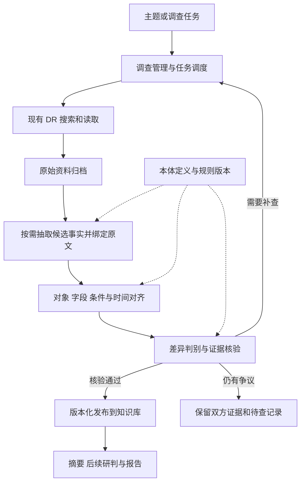

# 专题调查与知识维护管线方案

日期：2026年11月11日

## 一、系统定位与本轮目标

本项目建设面向企业、产品与技术专题的调查和知识维护管线。用户提出主题或调查任务后，系统组织公开资料采集，保留原始材料，将材料转化为具有对象、条件、时间和证据引用的结构化记录，并管理核验、争议与修订。后续研判模块使用这些知识与证据，进一步形成技术评价、竞争分析和影响判断。

本轮建设重点是贯通调查管理、对象对齐、证据核验和版本化入库。数据质量判断负责检查原文是否支持记录、对象是否对应、条件是否一致以及证据是否冲突；技术价值和趋势研判作为后续能力接入。

从基本需求出发，原始材料解决“信息从哪里来”，结构化知识解决“信息在说什么”，核验记录解决“在什么条件下可以使用”，修订与引用关系解决“变化后哪些内容需要重新检查”。这些能力共同支撑可持续维护的专题档案。

## 二、四层成果与知识状态

| 成果层次 | 保存内容 | 用户获得的功能 |
| --- | --- | --- |
| 原始资料 | 网页正文、可取得的页面快照或原始文件、来源地址、采集时间、内容版本、段落与表格定位 | 阅读原文、核对出处、查看历史材料 |
| 结构化知识 | 实体、属性值、关系、成立条件、时间、事实性质、证据引用和稳定标识 | 专题查询、字段筛选、对象比较、产品与技术图谱 |
| 摘要与研判 | 资料摘要、专题小结，以及后续分析判断和依据 | 快速理解材料，并逐步获得分析结论 |
| 报告 | 按用途组织的文字、表格、图谱及其引用版本 | 阅读、展示和导出成果 |

第二层保存实际字段值及其成立范围，稳定标识用于连接对象、属性、关系和证据。摘要与研判使用不同的内容类型：摘要复述材料，研判增加解释与推断。资料摘要可以直接依据原文生成，不必等待全部字段完成抽取；生成内容保留出处，不作为新增独立信源。

四层成果之间保存引用关系，支持从报告句段或数据库字段回查到当时采用的知识版本和来源快照。

知识状态通过两类逻辑视图管理，可以在同一业务数据库中实现：

- 当前可用视图：提供在指定条件和时间范围内，按照相应规则核验通过的记录。
- 核验修订视图：保留全部候选、争议、核验过程、停用记录和历史版本。

已接受入库与按新规则完成核验分别记录。历史数据继续可见，对尚未按当前规则核验的部分明确标记，并按需补验。

## 三、完整处理流程

流水线按材料逐批推进。采集和知识加工分别记录状态：资料可以先归档，已有或后续生成的结构化结果再进入核验。抽取暂停时，采集仍然能够正常完成。

## 四、调查管理

调查管理采用状态机管理阶段、任务依赖图安排执行、语言模型提出计划、现有排序算法调整执行顺序的组合。现有搜索和读取方法继续复用。

一项调查记录主题、核心问题、时间及来源范围、联网设置、交付目标、任务依赖、当前阶段、调用消耗和停止原因。每项补查任务关联触发它的核验项目，保存具体缺口及已检查过的材料。

| 机制 | 职责 |
| --- | --- |
| 状态机 | 管理计划、采集、等待加工、核验、完成、暂停和失败，限定允许的状态转换 |
| 任务依赖图 | 表达任务先后关系，例如先取得原始规格书，再核对表格参数 |
| 语言模型规划 | 将主题拆成调查任务，在出现新线索或明确缺口时建议补充任务 |
| 现有排序模块 | 利用相关性、目标缺口和信息增量调整搜索、读取与任务顺序 |
| 持久化与幂等处理 | 中断后接续已有任务，复用归档资料，避免重复采集与写入 |

调查管理放在现有采集执行器外层，沿用现有任务标识和运行记录。项目已经使用 LangGraph；跨进程恢复需完善持久化检查点及与现有业务状态的对应关系。持久化检查点不会自动消除重复副作用，写入和外部调用仍需通过任务标识、来源版本和处理版本识别重复执行。

核验反馈生成明确的材料请求，例如“这条功率记录缺少带宽条件，需要回查规格书表头”。系统先检查已归档原文，仍不能解决时，再按联网设置和任务预算安排外部搜索。普通空字段允许保留，调查无需为了填满数据库全部列而扩展范围。

## 五、本体作为共同处理契约

本体为抽取、对齐、比较、证据核验和有限推理提供共同定义。工程上将领域定义、比较规则和证据策略分开维护，并共同绑定发布版本。

| 内容 | 具体定义 |
| --- | --- |
| 对象、属性和关系 | 企业、产品、型号、版本、项目、事件、指标及关系方向和基数 |
| 成立条件 | 型号、版本、工况、统计口径、测量方法、地点角色、单位与比较容差 |
| 时间与变化 | 有效时间、发布时间、系统记录时间、计划或完成状态，以及状态和关系变化的证据要求 |
| 信源与证据 | 来源身份、材料类型、引用出处、原始来源组、事实所需证据类型与独立来源要求 |
| 推理规则 | 前提类型、变量对应、适用范围、允许运算及输出记录 |

每轮加工固定本体与规则版本。先建立第一版稳定契约，后续发现定义缺口时形成变更建议，检查旧新映射和影响范围，再发布新版本并复核受影响记录。新事实进入数据库属于知识更新；概念、关系、条件或规则定义改变，才涉及相应本体或规则版本的演化。

## 六、候选抽取与对象对齐

候选记录保存对象或事件、属性或关系、原始值、标准值、成立条件、有效时间、事实性质、原文位置和本体版本。复杂句拆为可分别核验的记录，同时保存它们属于同一事件或表格行的关联。

语言模型或外部抽取工具提出候选字段，程序检查字段类型、允许枚举和原文定位。原文存在某个数值只说明数值出现过，还需核对它属于哪个对象、表格列和条件。表格证据尽可能绑定行列标题、单位和脚注；旧归档未保留足够结构时，记录定位能力不足并安排回查。

实体对齐顺序为：先查稳定标识、准确型号及已确认别名；再以名称相似度生成候选；结合组织、类型、版本、时间和上下文排除误匹配。明确匹配的绑定现有实体标识，身份不明的保留待查，避免通过名称相似度直接合并。

属性和关系映射到已有定义，保留原始表述和映射依据。单位、日期角色、事件状态及条件同步标准化。无法由现有定义表达的内容进入扩展建议，不直接新增同义字段。

## 七、差异判别与证据核验

比较包括三条路径：抽取结果与原文比较；新知识与已有知识比较；摘要或推导结论与其前提比较。新旧知识先对齐对象、属性、事实性质、条件及有效时间，再分流等价表达、条件分离和有变更证据支持的正常演化。只知发布时间先后，不足以认定旧记录已被替代。

差异的内容级别用于分配核验对象和定位修改位置：

| 内容级别 | 核验对象 | 主要处理方式 |
| --- | --- | --- |
| 字段事实级 | 数值、日期、地点、数量及对应原文 | 单位换算、区间与容差比较、日期精度和地点角色检查 |
| 对象与条件级 | 实体、型号、版本、工况、范围、表头和脚注 | 身份匹配、条件比较和字段绑定校验 |
| 语义关系级 | 主客体、关系方向、否定、事件状态和确定程度 | 结构化语义比较，模型辅助定位复杂表达，保留未明项目 |
| 归纳推理级 | 前提、规则、结论范围及反例 | 检查前提覆盖和规则适用性，执行明确运算，识别超范围概括 |

同一原因可以产生多个级别的差异记录，记录之间保留共同原因标识，最终按目标位置合并相同修订动作。四级描述错误内容，不表示信源等级或处理紧急程度。

每项核验保存规则标识及版本、输入字段、证据位置、执行运算、结果和未明事项。结果采用通过、失败、未明三种状态，未明不以否定或无冲突替代。归纳推理级第一版覆盖已有摘要中的明确范围扩大、前提遗漏及登记规则检查；复杂产业研判后续扩展。

信源按具体断言的证据路径分为直接信源、有明确出处的转述信源、出处或形成过程未明的信源。直接信源核查原文与适用范围；转述材料追溯原始出处；出处未明材料保留线索并补查。企业规格书可以支持企业对某型号作出的声明，实测性能需要相应测试材料。

独立性按原始形成过程判断。转载、摘编和翻译指向相同原始材料时归为同一来源组；文本近重复仅提供同源线索。不同发布者不自动构成独立证据，引用环中未取得原始材料的记录保留待查状态。最低证据数量按事实类型和理由配置，不对所有事实统一要求两个来源。

核验完成后按结果选择修订、撤回、补查、争议或维持。合格直接证据仍矛盾时保存双方及共同范围，不单凭来源等级、发布时间或支持数量覆盖另一方。已证错误先停止作为当前依据，更正候选仍待核验时继续保持停用。

## 八、入库与关联修订

继续使用现有结构化记录、程序校验、写入预览和参数化 SQL 提交路径，在写入计划前接入核验结果。结构化记录至少能关联来源链、核验项目、差异与处理决定、知识及规则版本、成果引用关系。

修订采用新增版本和更新当前入口的方式，旧来源和旧记录保持可追溯。提交前检查本轮读取的知识、来源及规则版本是否仍有效，变化时重新核验受影响部分。数据库发布通过事务完成；未来接入文件成果时，先保存不可变成果版本，再通过事务更新引用指针。

实际输入材料与支持依据分别记录。事实停用或变更后，沿实际引用找到受影响的字段、摘要和后续成果，逐项复核；具有有效替代依据的内容可以保留，依据未明的标为待复核。第一版完成知识记录及引用状态更新，复杂报告句段自动重写后续实现。

## 九、开源复用与现有工程衔接

| 功能 | 复用组件 | 本项目需要实现的部分 |
| --- | --- | --- |
| 调查状态与恢复 | 已有 LangGraph | 调查状态、业务任务衔接、持久化及恢复策略 |
| 本体定义与抽取契约 | LinkML 和已有 Pydantic | 现有字段映射、单一权威定义、版本管理、领域比较与证据规则 |
| 名称对齐 | RapidFuzz | 类型、组织、型号与上下文约束，明确候选与已确认身份的区别 |
| 单位标准化 | Pint | 比较条件、区间与容差规则，对数等特殊单位的明确处理 |
| 引用追溯和影响定位 | 已有 NetworkX | 来源归组依据、实际引用登记、影响范围和局部修订逻辑 |
| 发布与历史保存 | 已有 SQLite 和参数化 SQL 写入流程 | 核验状态、版本检查、当前视图和事务衔接 |

开源组件提供可复用的执行、校验与算法能力。领域证据要求、四级差异路由和处理动作由本项目依据技术交底书实现。第一版采用现有后端内的模块组织，图约束确有需要时再增加 RDF 和 SHACL 适配。

当前工程已经具备原文归档、业务字段库、来源引用、离线结构化结果导入及图谱展示基础。专题调查中的部分快照和缺口读取仍需与新研究库统一。已有动态增列和修订相关代码可供复核借鉴，实验运行及数据保持独立，不接入业务前后端。

## 十、实施顺序与验收目标

1. 统一业务读取入口，明确候选记录、核验结果、补查任务和发布结果四类接口，建立第一版本体和规则快照。
2. 使用现有少量结构化结果贯通对象对齐、原文核验、差异处理、版本化入库和历史查看。抽取模型保持关闭，已有结果可独立加工。
3. 将核验产生的具体缺口接回调查管理，完善等待、暂停、恢复和结束状态，避免无限补查。
4. 接入现有任务、行动和知识库窗口。任务窗口管理调查，行动窗口展示实际执行事件，知识库展示字段、来源、争议及版本，现有图谱继续沿用。

验收围绕完整路径进行：一条资料从哪里来，被理解成什么，为什么可以入库，存在什么疑点，后来如何修改，都应可查询。代表性案例包括同源转载去重、不同条件并存、表格错列、计划误写完成、概括超范围、已证错误停用及中断后不重复发布。

## 参考资料

- 用户技术交底书：`专利/2026-1111-预测与拆解可执行性修订/02_知识库冲突消解与修订_技术交底书.docx`，重点参考 S1—S5。
- [LangGraph](https://github.com/langchain-ai/langgraph) 与[持久化机制](https://docs.langchain.com/oss/python/langgraph/persistence)。
- [LinkML](https://github.com/linkml/linkml) 与[生成器文档](https://linkml.io/linkml/generators/)。
- [RapidFuzz](https://github.com/rapidfuzz/RapidFuzz)。
- [Pint](https://github.com/hgrecco/pint)。
- [NetworkX](https://github.com/networkx/networkx)。
- [OpenCTI 来源可靠性与信息置信度](https://docs.opencti.io/latest/usage/reliability-confidence/)，用于参考信息质量管理设计。
